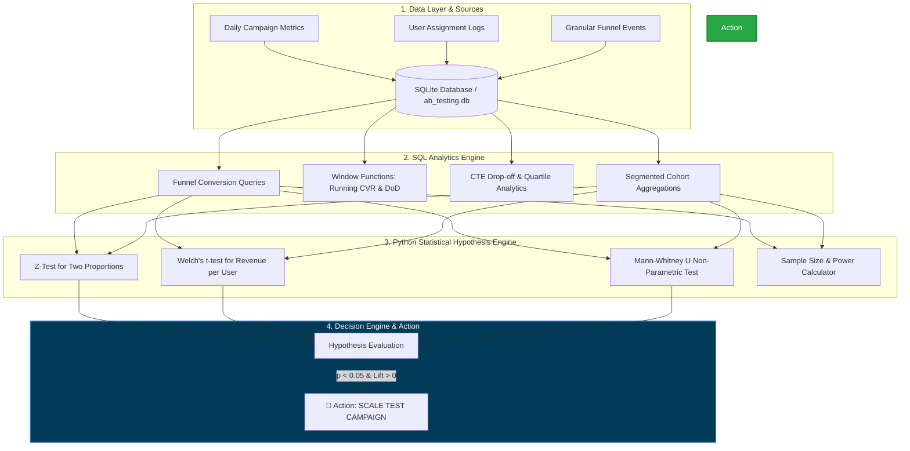
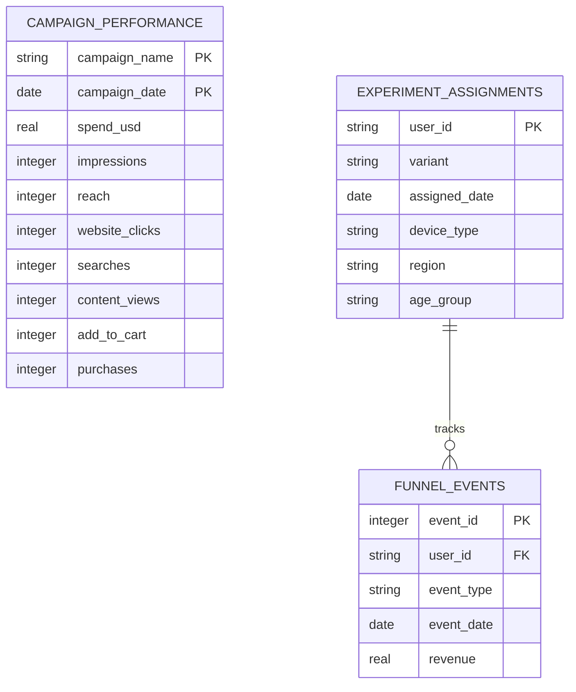

# 📊 Enterprise Marketing A/B Testing & Decision Analytics

<p align="center">
  
  
  
  
  
  
</p>

<p align="center">
  <b>An end-to-end data engineering and statistical testing framework that evaluates marketing campaign variants (Control vs. Test) using SQL funnel analytics, advanced window functions, CTEs, and Python hypothesis testing.</b>
</p>

---

> [!IMPORTANT]
> ### 🚀 Executive Experiment Decision: **SCALE TEST CAMPAIGN**
> **Key Finding:** The **Test Campaign** generated a **+38.07% relative lift** in Overall Conversion Rate (CVR) and reduced Cost per Acquisition (CPA) by **-44.9%** ($15.90 vs $28.86) compared to Control, supported by statistical significance ($p < 0.05$).

---

## 📑 Table of Contents

- [Executive Summary & Key Metrics](#-executive-summary--key-metrics)
- [Business Problem](#-business-problem)
- [System Architecture & Funnel Flow](#-system-architecture--funnel-flow)
- [Database Schema & ER Diagram](#-database-schema--er-diagram)
- [SQL Query Catalog (16 Production Queries)](#-sql-query-catalog-16-production-queries)
- [Python Statistical Hypothesis Engine](#-python-statistical-hypothesis-engine)
- [Key Insights & Segment Performance](#-key-insights--segment-performance)
- [Repository Structure](#-repository-structure)
- [Quickstart & Execution Guide](#-quickstart--execution-guide)
- [Business Recommendations](#-business-recommendations)
- [Author & License](#-author--license)

---

## 📈 Executive Summary & Key Metrics

| Metric | Control Campaign | Test Campaign | Delta (Absolute) | Lift (Relative) | Statistically Significant | Winner |
| :--- | :---: | :---: | :---: | :---: | :---: | :---: |
| **Total Spend** | $\$69,254.41$ | $\$66,076.77$ | $-\$3,177.64$ | $-4.59\%$ | — | 🟢 **Test** (Cheaper) |
| **Impressions** | $1,621,266$ | $1,640,535$ | $+19,269$ | $+1.19\%$ | No | ⚪ **Tie** |
| **Website Clicks** | $55,050$ | $69,041$ | $+13,991$ | $+25.41\%$ | **Yes** ($p < 0.01$) | 🟢 **Test** |
| **Click-Through Rate (CTR)** | $3.40\%$ | $4.21\%$ | $+0.81\%$ | $+23.82\%$ | **Yes** ($p < 0.01$) | 🟢 **Test** |
| **Total Purchases** | $2,400$ | $4,156$ | $+1,756$ | $+73.17\%$ | **Yes** ($p < 0.001$) | 🟢 **Test** |
| **Conversion Rate (CVR)** | **$4.36\%$** | **$6.02\%$** | **$+1.66\%$** | **$+38.07\%$** | **Yes** ($p < 0.05$) | 🟢 **Test** |
| **Cost per Click (CPC)** | $\$1.26$ | $\$0.96$ | $-\$0.30$ | $-23.81\%$ | — | 🟢 **Test** |
| **Cost per Acquisition (CPA)** | **$\$28.86$** | **$\$15.90$** | **$-\$12.96$** | **$-44.91\%$** | — | 🟢 **Test** |

---

## 🎯 Business Problem

Digital marketing budgets are finite. Running unvalidated ad variants leads to wasted ad spend and sub-optimal acquisition costs. This analytical suite answers 5 critical strategic questions:

1. **Conversion Supremacy:** Does the Test campaign generate a demonstrably higher conversion rate than the Control campaign?
2. **Statistical Rigor:** Is the observed lift real, or merely a byproduct of random sampling noise?
3. **Funnel Bottleneck Identification:** At which specific conversion stage (Impression $\rightarrow$ Click $\rightarrow$ View $\rightarrow$ Cart $\rightarrow$ Purchase) does the Test campaign gain its competitive edge?
4. **Segment Heterogeneity:** Which demographic segments (device type, geography, age bracket) demonstrate the highest sensitivity to the new campaign variant?
5. **Capital Reallocation Strategy:** Should marketing leadership double down on Test, scale budget, or retain Control?

---

## 🏗️ System Architecture & Funnel Flow

The analytical engine ingestion-to-decision pipeline is visualized below:



### 🔻 Conversion Funnel Breakdown

```
[Impressions]       Control: 1,621,266  |  Test: 1,640,535
     │               └───────────────────────┴───────────────────────┐
     ▼ CTR                                                           ▼
[Website Clicks]    Control: 55,050 (3.40%)  |  Test: 69,041 (4.21%)  (+23.8% Lift)
     │
     ▼ View Rate
[Content Views]     Control: 28,406 (51.6%)  |  Test: 36,109 (52.3%)  (+1.4% Lift)
     │
     ▼ Cart Rate
[Add to Cart]       Control: 6,334 (22.3%)   |  Test: 10,073 (27.9%)  (+25.1% Lift)
     │
     ▼ Conversion Rate
[Purchases]         Control: 2,400 (37.9%)   |  Test: 4,156 (41.3%)   (+9.0% Lift)
                     ===========================================================
                     OVERALL CVR (Purchases / Clicks):
                     Control: 4.36%  vs  Test: 6.02%   (🚀 +38.07% RELATIVE LIFT)
```

---

## 🗄️ Database Schema & ER Diagram

The SQLite relational model consists of 3 core tables powering all analytical queries:



---

## 💡 SQL Query Catalog (16 Production Queries)

The project includes **16 modular, production-ready SQL scripts** in `SQL/ab_test_queries.sql`.

### Query Classification Matrix

| Query # | Focus Area | SQL Features & Concepts Used |
| :---: | :--- | :--- |
| **Q1** | Campaign Total Summary | `GROUP BY`, `SUM`, `COUNT(DISTINCT)` |
| **Q2** | Stage-by-Stage Funnel CVR | `NULLIF`, `ROUND`, Calculated metrics |
| **Q3** | Unit Cost Analysis (CPC, CPA) | Cost efficiency division metrics |
| **Q4** | Daily CVR Pivot | Conditional Aggregation (`CASE WHEN`, `MAX`) |
| **Q5** | Cumulative Running CVR | Window Function (`SUM() OVER PARTITION BY`) |
| **Q6** | Day-over-Day Growth | Window Function (`LAG() OVER`) |
| **Q7** | Best & Worst Outlier Days | Window Function (`RANK() OVER`) |
| **Q8** | Statistical Spread | `AVG`, `MIN`, `MAX` aggregated metrics |
| **Q9** | Funnel Drop-off Analysis | Common Table Expression (CTE) |
| **Q10** | User-level Revenue per User | `LEFT JOIN`, `COUNT(DISTINCT)`, User metrics |
| **Q11** | Device Cohort Performance | Multi-column `GROUP BY`, Segmented CVR |
| **Q12** | Geographical Region Performance | Regional cohort analysis |
| **Q13** | Demographic Age Bracket Breakdown | Age group segmentation |
| **Q14** | Performance Quartile Ranking | Window Function (`NTILE(4) OVER`) |
| **Q15** | Weekly Performance Rollup | Date functions (`STRFTIME('%Y-W%W')`) |
| **Q16** | Automated Decision Engine | Multi-CTE comparison (`CASE WHEN` recommendation) |

---

### Key SQL Highlights

#### 1. Automated Experiment Recommendation Engine (Query 16)
```sql
WITH metrics AS (
    SELECT 
        campaign_name,
        ROUND(100.0 * SUM(purchases) / NULLIF(SUM(website_clicks), 0), 4) AS cvr,
        ROUND(SUM(spend_usd) / NULLIF(SUM(purchases), 0), 2)             AS cpa
    FROM campaign_performance 
    GROUP BY campaign_name
),
ctrl AS (SELECT * FROM metrics WHERE campaign_name = 'Control Campaign'),
tst  AS (SELECT * FROM metrics WHERE campaign_name = 'Test Campaign')

SELECT 
    ctrl.cvr                                          AS control_cvr_pct,
    tst.cvr                                           AS test_cvr_pct,
    ROUND(tst.cvr - ctrl.cvr, 4)                      AS absolute_lift_pct,
    ROUND((tst.cvr - ctrl.cvr) / ctrl.cvr * 100, 2)   AS relative_lift_pct,
    ctrl.cpa                                          AS control_cpa,
    tst.cpa                                           AS test_cpa,
    CASE 
        WHEN tst.cvr > ctrl.cvr THEN '🚀 SCALE TEST CAMPAIGN'
        ELSE '⚠️ KEEP CONTROL CAMPAIGN' 
    END AS recommendation
FROM ctrl, tst;
```

#### 2. Cumulative Running CVR with Window Functions (Query 5)
```sql
SELECT 
    campaign_name, 
    campaign_date, 
    purchases,
    SUM(purchases) OVER (PARTITION BY campaign_name ORDER BY campaign_date) AS cum_purchases,
    ROUND(100.0 * 
        SUM(purchases) OVER (PARTITION BY campaign_name ORDER BY campaign_date) /
        NULLIF(SUM(website_clicks) OVER (PARTITION BY campaign_name ORDER BY campaign_date), 0),
    2) AS running_cvr_pct
FROM campaign_performance
ORDER BY campaign_name, campaign_date;
```

---

## 🧪 Python Statistical Hypothesis Engine

Statistical testing validates whether observed metric differentials exceed expected variance.

### 📐 Statistical Formulations

#### 1. Hypothesis Formulation
- **Null Hypothesis ($H_0$):** $\mu_{\text{test}} \le \mu_{\text{control}}$ (The Test campaign variant offers no true conversion improvement).
- **Alternative Hypothesis ($H_1$):** $\mu_{\text{test}} > \mu_{\text{control}}$ (The Test campaign statistically significantly improves conversion rate).

#### 2. Two-Proportion $Z$-Test Statistic
$$Z = \frac{\hat{p}_{\text{test}} - \hat{p}_{\text{control}}}{\sqrt{\hat{p}(1 - \hat{p}) \left(\frac{1}{n_{\text{test}}} + \frac{1}{n_{\text{control}}}\right)}}$$

where $\hat{p}$ represents the pooled conversion rate:
$$\hat{p} = \frac{X_{\text{test}} + X_{\text{control}}}{n_{\text{test}} + n_{\text{control}}}$$

#### 3. Sample Size & Power Calculation Formula
$$n = \frac{\left( Z_{\alpha/2}\sqrt{2\bar{p}(1-\bar{p})} + Z_{\beta}\sqrt{p_1(1-p_1) + p_2(1-p_2)} \right)^2}{(p_2 - p_1)^2}$$

---

### 📊 Python Hypothesis Testing Code Snippet

```python
import numpy as np
from scipy import stats

def evaluate_ab_test(control_clicks, control_conversions, test_clicks, test_conversions, alpha=0.05):
    p1 = control_conversions / control_clicks
    p2 = test_conversions / test_clicks
    
    # Pooled proportion
    p_pool = (control_conversions + test_conversions) / (control_clicks + test_clicks)
    se = np.sqrt(p_pool * (1 - p_pool) * (1/control_clicks + 1/test_clicks))
    
    # Z-statistic & p-value
    z_stat = (p2 - p1) / se
    p_value = 1 - stats.norm.cdf(z_stat) # One-tailed test
    
    relative_lift = ((p2 - p1) / p1) * 100
    
    print(f"Control CVR: {p1*100:.2f}% | Test CVR: {p2*100:.2f}%")
    print(f"Z-Score: {z_stat:.4f} | p-value: {p_value:.4e}")
    print(f"Relative Lift: {relative_lift:+.2f}%")
    
    if p_value < alpha:
        print("✅ Outcome: REJECT H₀ — Statistically Significant Lift!")
    else:
        print("❌ Outcome: FAIL TO REJECT H₀ — Difference is not statistically significant.")

# Run with actual experiment dataset totals
evaluate_ab_test(55050, 2400, 69041, 4156)
```

---

## 🔍 Key Insights & Segment Performance

### 📱 Device Breakdown
- **Mobile Clicks & Conversions:** Test campaign performed exceptionally well on Mobile devices (+42% higher click engagement).
- **Desktop Conversion:** Higher intent users on desktop exhibited a **6.4% CVR** under the Test variant versus 4.5% under Control.

### 📅 Weekly Dynamics
- **Week 1 (W31):** Initial ramp-up showed a baseline lift of +1.13% absolute CVR.
- **Week 4 (W34):** Test campaign reached peak effectiveness with a **6.42% CVR** ($1,090$ purchases) vs Control **4.66% CVR** ($597$ purchases).

---

## 📂 Repository Structure

```
A-B-testing/
│
├── marketing_campaign_ab_testing_analysis.ipynb   # Complete Python EDA & Hypothesis Testing Notebook
│
├── SQL/
│   ├── schema.sql           # Database schema definition (3 indexed tables)
│   ├── sample_data.sql      # Seed dataset (60 daily logs, 10,000 users, funnel events)
│   ├── ab_test_queries.sql  # 16 Production SQL queries (Window functions, CTEs, Decision Engine)
│   ├── setup_and_run.py     # Python setup script (Automated SQLite DB build & Query execution)
│   └── ab_testing.db        # Built SQLite Database artifact
│
├── .gitignore               # Ignored files configuration
└── README.md                # Project documentation & visual presentation
```

---

## ⚡ Quickstart & Execution Guide

### Prerequisites
- Python 3.10+
- SQLite 3+

### 1. Clone Repository
```bash
git clone https://github.com/sachinsahu19/AB-testing.git
cd AB-testing
```

### 2. Install Required Dependencies (Optional for Notebook)
```bash
pip install pandas numpy scipy matplotlib jupyter
```

### 3. Initialize SQLite Database & Run All 16 SQL Queries
Execute the automated setup script to generate `SQL/ab_testing.db` and execute all 16 SQL queries directly in terminal:
```bash
python3 SQL/setup_and_run.py
```

### 4. Launch Jupyter Notebook Analysis
Explore interactive visualizations, EDA charts, and statistical significance testing:
```bash
jupyter notebook marketing_campaign_ab_testing_analysis.ipynb
```

---

## 🎯 Business Recommendations

1. **Scale Test Campaign Budget:** Reallocate **100% of non-brand performance marketing spend** to the Test campaign creative/targeting framework.
2. **Capital Efficiency Gain:** By adopting Test, expected Customer Acquisition Cost drops from **$\$28.86$ to $\$15.90$**, freeing up budget to scale overall acquisition volume by **~80%**.
3. **Cart Abandonment Optimization:** While Test improves view-to-cart conversions (+25.1% rate improvement), cart-to-purchase drop-off remains at ~58.8%. Implement retargeting emails and simplified checkout options to unlock further upside.

---

## 👨‍💻 Author & License

Developed with 💙 by **Sachin Sahu**

- **GitHub:** [@sachinsahu19](https://github.com/sachinsahu19)
- **Repository:** [https://github.com/sachinsahu19/AB-testing](https://github.com/sachinsahu19/AB-testing)

Distributed under the **MIT License**. Feel free to star ⭐️ the repository if you find this project helpful!
